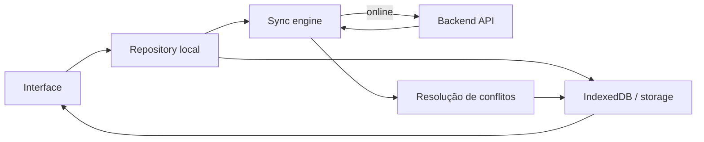
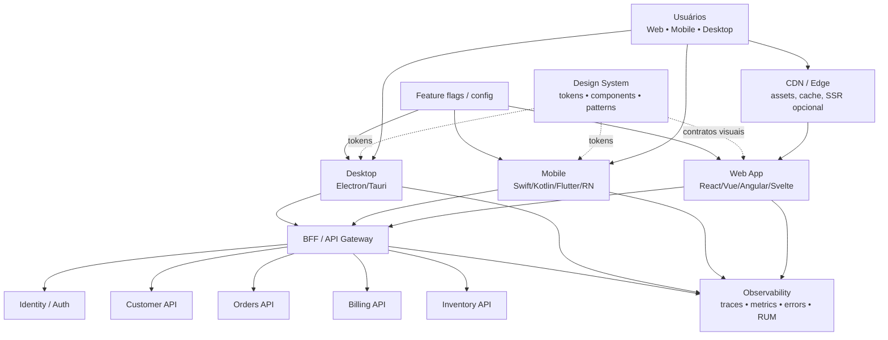
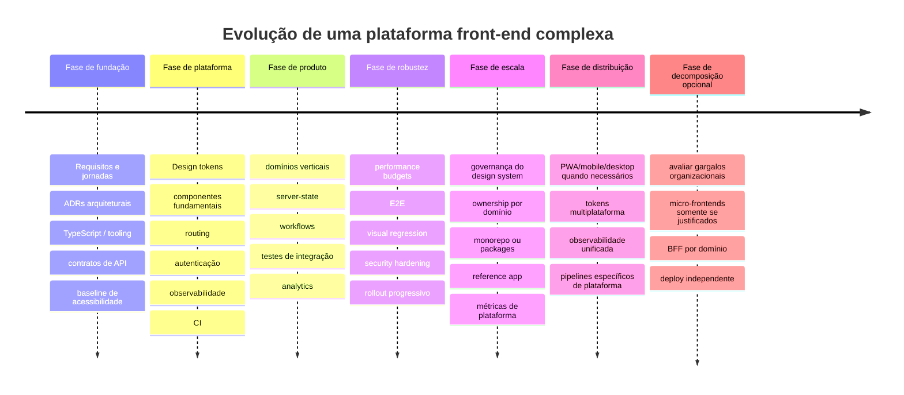
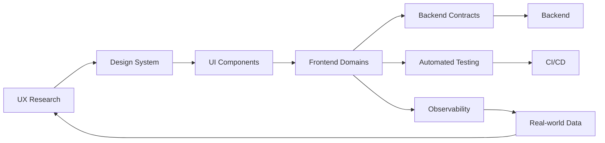

# Front-end para aplicações, sites e sistemas complexos: estudo aprofundado de UI, UX, arquitetura e engenharia

*Out 15-10-2026 às 12:47 — referência temporal: estado das tecnologias e documentação pública disponível até esta data.*

## Resumo executivo

Front-end moderno deixou de ser sinônimo de “camada visual”. Em aplicações relevantes, ele é simultaneamente **sistema de interação, runtime distribuído, consumidor de APIs, camada de estado, superfície de segurança, plataforma de acessibilidade e principal responsável pela percepção de qualidade do produto**. A arquitetura adequada muda radicalmente conforme o produto seja um site orientado a conteúdo, uma SPA operacional, uma PWA offline, um aplicativo móvel, um desktop ou um sistema corporativo composto por vários domínios.

A conclusão central deste estudo é que **não existe um framework universalmente superior**. Há combinações mais coerentes com determinados problemas:

| Cenário predominante | Direção recomendada |
|---|---|
| Site público, conteúdo, SEO, landing pages, e-commerce | SSR/SSG/híbrido; React + Next/React Router, Vue + Nuxt, SvelteKit ou Angular híbrido |
| SaaS, dashboard, ERP, CRM, painel administrativo | SPA ou híbrido; React, Angular, Vue; modular monolith como padrão inicial |
| Sistema corporativo com muitos times independentes | Componentes + design system + monorepo/modularização; micro-frontends somente quando independência organizacional justificar o custo |
| PWA/offline-first | Stack web + Service Worker + IndexedDB/cache + política explícita de sincronização |
| App iOS/Android com UX profundamente integrada ao SO | SwiftUI + Swift e Jetpack Compose + Kotlin |
| App móvel multiplataforma centrado em UI | Flutter ou React Native |
| Aplicativo “web-first” distribuído nas lojas | Ionic/Capacitor |
| Desktop multiplataforma com forte reutilização web | Electron quando ecossistema/compatibilidade são prioritários; Tauri quando footprint e controle de privilégios pesam mais |
| Produto que precisa de web + mobile + desktop | Compartilhar **design, contratos, domínio e tokens**, não necessariamente forçar uma única tecnologia de renderização |

No lado web, **SSR versus SPA não deve mais ser tratado como escolha binária**. React Server Components, Next.js, Nuxt, Angular e SvelteKit permitem combinar conteúdo estático, renderização sob demanda, streaming e componentes interativos. A própria documentação do React recomenda começar aplicações completas com um framework em vez de montar manualmente roteamento, obtenção de dados e infraestrutura; Vue e Angular também possuem caminhos formais para SSR e renderização híbrida. citeturn5search0turn5search1turn0search2turn0search5

Para aplicações complexas, a recomendação arquitetural mais importante é **começar por um monólito frontend modular e orientado a domínios**, introduzindo micro-frontends apenas quando houver múltiplas equipes realmente autônomas, ciclos de implantação independentes ou necessidade concreta de migração incremental de um legado. Estudos empíricos recentes confirmam os benefícios organizacionais dos micro-frontends, mas também registram aumento de complexidade em dependências, ambientes, debugging e testes de integração; um estudo de caso de 2025 chegou à conclusão de que a solução funcionou bem, mas que uma arquitetura monolítica poderia ter atendido a requisitos semelhantes. citeturn4search0turn6academia6turn6academia7

Acessibilidade deve entrar no Definition of Done. Para web, **WCAG 2.2 AA** é a baseline recomendada; existe tradução brasileira publicada pelo W3C Brasil. Aplicações ricas também precisam de semântica, navegação por teclado, foco, leitores de tela, zoom/reflow, alvos de toque e testes manuais, pois ferramentas automatizadas detectam apenas parte dos problemas. citeturn3search0turn13search0turn2search10turn7search1

Performance deve ser tratada como requisito de produto, não otimização tardia. Na web, um baseline mensurável é manter, no 75º percentil, **LCP ≤ 2,5 s, INP ≤ 200 ms e CLS ≤ 0,1**. Em mobile e desktop, a mesma disciplina deve aparecer como tempos de inicialização, frames perdidos/jank, memória, consumo de CPU, ANRs/crashes e latência das jornadas críticas. citeturn3search4turn3search5turn1search1turn1search5

Finalmente, para um sistema grande, o front-end de maior qualidade tende a ter quatro características:

**design system governado + arquitetura de domínios + pipeline automatizado + telemetria de experiência real.**

Sem esses quatro pilares, trocar React por Vue, Angular por Svelte ou Electron por Tauri costuma apenas deslocar o problema.

## Mapa de aplicações e seus requisitos de front-end

Uma primeira decisão arquitetural correta exige entender **que tipo de produto está sendo construído**. “Aplicativo web” é amplo demais para servir como requisito técnico.

| Tipo | Características | Prioridades de front-end | Arquitetura típica | Principal risco |
|---|---|---|---|---|
| **Site tradicional / conteúdo** | Conteúdo público, navegação por URL, SEO | HTML inicial rápido, semântica, SEO, acessibilidade, cache | SSG/SSR + hidratação seletiva | JavaScript excessivo |
| **SPA** | Interface altamente interativa após o boot | Estado, roteamento, caching de API, feedback instantâneo | CSR + API/BFF | bundle inicial e complexidade de estado |
| **PWA** | Web instalável, funcionamento degradado/offline | cache, sincronização, instalação, atualização, recuperação de rede | SPA/SSR + Service Worker + armazenamento local | cache inconsistente e conflito de dados |
| **Mobile nativo** | UX integrada ao SO e APIs de dispositivo | lifecycle, gestos, acessibilidade nativa, bateria, memória | SwiftUI/Compose + arquitetura por camadas | duplicação entre iOS/Android |
| **Cross-platform** | Uma base atendendo iOS/Android | adaptação por plataforma, plugins, performance | Flutter ou React Native | abstração inadequada de diferenças nativas |
| **Híbrido WebView** | Código web empacotado como aplicativo | responsividade mobile, bridge nativa, offline | Ionic/Capacitor | UX parecer “site dentro de app” |
| **Desktop** | Janelas, menus, filesystem, atalhos, IPC | performance em idle, memória, segurança de privilégios | Electron/Tauri + framework UI | ampliar superfície de ataque |
| **Corporativo complexo** | Muitos módulos, regras e times | governança, RBAC, tabelas/formulários, consistência, testes | modular monolith ou micro-frontends + BFF | entropia arquitetural |

### Sites e experiências orientadas a conteúdo

Sites institucionais, portais, documentação, lojas e landing pages devem favorecer **HTML útil antes da execução intensiva de JavaScript**. Vue recomenda explicitamente evitar uma SPA puramente client-side quando tempo até conteúdo é importante; SSR e SSG melhoram time-to-content e tornam conteúdo imediatamente disponível ao crawler. React atualmente recomenda frameworks full-stack para aplicações completas, permitindo CSR, SSG e SSR por rota. citeturn0search2turn0search7turn5search1

Uma arquitetura coerente é:

```text
CDN
 ├── HTML estático/SSR
 ├── CSS crítico
 ├── imagens/fontes otimizadas
 └── JS somente para as regiões interativas
```

A pergunta correta deixa de ser “SSR ou SPA?” e passa a ser **“qual parte precisa efetivamente virar JavaScript no dispositivo do usuário?”**

### SPAs e sistemas operacionais de negócio

ERP, CRM, WMS, sistemas financeiros, consoles administrativos e ferramentas internas normalmente têm características diferentes: sessões longas, grande quantidade de ações, tabelas, filtros, formulários, atalhos, permissões e estado transitório.

Nesse contexto, CSR pode ser totalmente legítimo. A própria documentação do Vue observa que SSR pode ser excesso para dashboards internos nos quais algumas centenas de milissegundos adicionais no primeiro carregamento não são críticas. citeturn0search2

O desafio central passa de SEO para:

**estado de servidor ≠ estado global ≠ estado local de UI.**

Misturar os três é uma das causas mais frequentes de complexidade artificial.

Uma divisão saudável é:

```text
Server state
API, cache, paginação, invalidação
         │
         ▼
Domain/application state
sessão, permissões, workflows
         │
         ▼
Local UI state
modal, expansão, input temporário, seleção
```

Em React, por exemplo, Redux Toolkit/RTK Query continua sendo apropriado quando existe estado compartilhado complexo; a própria documentação recomenda RTK Query para obtenção e cache de dados quando Redux está presente. Vue recomenda Pinia para aplicações novas que realmente necessitem de store compartilhada. citeturn4search6turn0search3

### PWAs

PWA não é “um site com ícone”. É uma arquitetura web que adiciona **instalabilidade, resiliência de rede e capacidades locais**. Service Workers podem interceptar requisições, servir cache e permitir experiências offline; IndexedDB, Cache Storage e armazenamento persistente são peças relevantes para aplicações offline-first. citeturn2search7turn2search8

O fluxo ideal é explícito:



Em uma PWA séria, a UX deve prever estados como **offline, sincronizando, sincronizado, atualização disponível, falha parcial e conflito**, em vez de simplesmente mostrar um spinner infinito quando a rede some.

### Mobile nativo, cross-platform e híbrido

SwiftUI oferece UI declarativa, integração com UIKit/AppKit, acessibilidade e localização integradas ao ecossistema Apple. Jetpack Compose é a recomendação moderna do Android para UI nativa e possui suporte explícito para layouts adaptativos, acessibilidade, testes e múltiplos form factors. citeturn1search0turn1search4turn1search6

Flutter segue um modelo diferente: usa seu próprio mecanismo de renderização em vez dos widgets visuais nativos do sistema, dando alto controle e consistência sobre pixels e comportamento; a base pode atender mobile, desktop, web e embedded. citeturn11search7turn11search8

React Native, por sua vez, preserva o modelo React e integra a UI às plataformas host. Sua arquitetura Fabric/JSI foi projetada para melhorar interoperabilidade, inicialização, type safety e comunicação entre JavaScript e código da plataforma. citeturn1search13

Capacitor representa outro ponto do espectro: mantém uma aplicação essencialmente web dentro de um runtime nativo e expõe funcionalidades de iOS/Android por plugins Swift/Java/JavaScript. citeturn6search0turn6search1

Benchmarks acadêmicos também sugerem cautela com “framework X sempre é mais rápido”. Estudos recentes encontram rankings diferentes dependendo de startup, memória, rendering, interação e workload; um estudo empírico publicado em setembro de 2026 concluiu que as vantagens dependem do atributo de qualidade, carga, plataforma e limite do que está sendo medido, em vez de existir um vencedor absoluto. citeturn15search3turn15academia11

### Desktop

Electron combina Chromium e Node.js em arquitetura multiprocessos com processo principal e renderers. Isso facilita reutilizar tecnologias web e acessar APIs nativas, porém amplia a responsabilidade sobre memória, CPU e principalmente segurança. citeturn2search2turn2search1

Tauri adota outra abordagem: o frontend roda no WebView do sistema e acessa funcionalidades privilegiadas através de uma fronteira IPC com código Rust e permissões/capabilities explicitamente configuradas. A ausência de um Chromium empacotado é um dos motivos de seus binários poderem ser significativamente menores. citeturn2search4turn2search5

Para desktop, portanto:

**Electron** tende a favorecer máxima previsibilidade do runtime web e maturidade do ecossistema.

**Tauri** tende a favorecer footprint, princípio do menor privilégio e integração Rust/WebView.

Nenhum deles elimina a obrigação de desenhar uma UX de desktop: menu, teclado, múltiplas janelas, drag-and-drop, system tray, atualizações, filesystem e comportamento de foco diferem profundamente de uma página web.

## UI e UX como infraestrutura transversal

Uma interface de alta qualidade não nasce de “CSS bonito”. Ela resulta de um conjunto de propriedades verificáveis.

### Acessibilidade

Para web, **WCAG 2.2 AA** deve ser tratada como baseline de engenharia. WCAG 2.2 acrescentou requisitos como foco não obscurecido, alternativas a arrastar, tamanho mínimo de alvo e redução de entrada redundante; a tradução pt-BR está disponível pelo W3C Brasil. citeturn3search0turn13search0

Em sistemas ricos, isso significa:

| Área | Regra prática |
|---|---|
| Estrutura | HTML semântico antes de ARIA |
| Teclado | Todo fluxo essencial operável sem mouse |
| Foco | visível, previsível e restaurado após modais/rotas |
| Forms | label, erro e instrução programaticamente associados |
| Conteúdo dinâmico | live regions quando realmente necessário |
| Responsividade | preservar funcionalidade em zoom/reflow |
| Movimento | respeitar preferência de movimento reduzido |
| Contraste | tokens aprovados, não valores arbitrários |
| Leitores de tela | testar NVDA/VoiceOver/TalkBack conforme plataforma |
| QA | automação + teste manual + usuários reais |

ARIA existe justamente para acrescentar semântica a widgets e conteúdo dinâmico que HTML puro não consegue representar adequadamente, mas não substitui uma estrutura semântica correta. citeturn2search10

WCAG também exige que conteúdo relevante possa refluír sem perda de informação ou funcionalidade; para conteúdo vertical, o critério de reflow considera uma largura equivalente a 320 CSS px. citeturn12search5

No contexto brasileiro, projetos governamentais ainda possuem referências adicionais no eMAG e no Padrão Digital de Governo, cujo Design System inclui recomendações de acessibilidade por componente. citeturn13search1turn13search2turn13search3

### Responsividade deve virar adaptabilidade

O padrão antigo “desktop / tablet / mobile” é insuficiente para 2026.

Android recomenda pensar por **window size**, panes, reflow e mudanças de apresentação, contemplando telefones, tablets, dobráveis, desktop windowing e multitarefa. citeturn12search3

Uma arquitetura de componentes deve responder a:

```text
largura + altura + densidade + orientação
+ modalidade de input
+ preferência do usuário
+ capacidade do dispositivo
```

Em vez de:

```text
if (isMobile) ...
```

Um exemplo clássico é list-detail:

```text
Compacto
┌─────────────┐
│ Lista       │
│             │
└─────────────┘
       ↓
┌─────────────┐
│ Detalhe     │
└─────────────┘

Expandido
┌────────┬──────────────────┐
│ Lista  │ Detalhe          │
│        │                  │
│        │                  │
└────────┴──────────────────┘
```

O Material Design documenta justamente layouts canônicos como feed, list-detail e supporting pane para diferentes breakpoints. citeturn9search3

### Performance percebida e performance real

Na Web:

| Métrica | Meta recomendada |
|---|---:|
| LCP | ≤ 2,5 s |
| INP | ≤ 200 ms |
| CLS | ≤ 0,1 |
| Medição | 75º percentil, mobile e desktop |

Essas são as metas oficiais atuais de Core Web Vitals. citeturn3search5

Entretanto, um sistema pode passar Core Web Vitals e continuar desagradável. Também devem ser instrumentados:

**tempo de rota → conteúdo útil, latência de busca, feedback após salvar, duração de operações, erro de API, memória, tamanho de bundles e frequência de long tasks.**

No mobile, Jetpack Compose recomenda medir release builds e reduzir recomposições desnecessárias; SwiftUI fornece Instruments especificamente para localizar atualizações de views longas e hitches. citeturn1search5turn1search1

No desktop, Electron é explícito: não bloquear main process/UI thread; trabalho pesado deve ir para workers ou processos separados, e performance deve ser medida através de profiling em vez de otimizações por intuição. citeturn2search1

### Design system

Um design system maduro contém pelo menos:

```text
Fundamentos
 ├─ cor
 ├─ tipografia
 ├─ espaçamento
 ├─ grid
 ├─ elevação
 └─ motion
       ↓
Tokens
       ↓
Primitivos
       ↓
Componentes
       ↓
Patterns
       ↓
Templates
       ↓
Produtos
```

Tokens devem representar **decisões semânticas**, e não simplesmente números.

Preferível:

```text
color.text.primary
color.surface.danger
spacing.control.inline
motion.duration.feedback
radius.control
```

a:

```text
gray500
red700
spacing16
```

Material 3 usa design tokens precisamente para transportar decisões de estilo entre design, código, ferramentas e plataformas. citeturn9search0turn9search2

A governança é tão importante quanto os componentes. O GOV.UK Design System exige evidência de utilidade, pesquisa com usuários — incluindo pessoas com deficiência — consistência, versatilidade e testes em browsers, tecnologias assistivas e dispositivos antes de determinados componentes serem publicados. citeturn9search4turn9search5

### Microinterações e motion

Motion deve explicar algo:

```text
ação → resposta → alteração de estado
```

e não simplesmente “ficar bonito”.

Apple recomenda movimento intencional, breve, cancelável e não utilizado como único canal de informação, considerando inclusive configurações de acessibilidade. citeturn12search2

Material 3 Expressive passou a empregar um sistema baseado em springs e tokens de movimento, permitindo que o mesmo vocabulário de animação seja aplicado consistentemente entre componentes. citeturn12search0

Exemplos de microinteração útil:

```text
Salvar
  ↓
estado "saving"
  ↓
sucesso
  ↓
feedback discreto
```

```text
Drag item
  ↓
elevação/preview
  ↓
target válido destacado
  ↓
drop
  ↓
confirmação visual + anúncio acessível
```

### Internacionalização

Internacionalização não é um `translations.json` no fim do projeto.

É necessário prever:

**Unicode, pluralização, formatação de números/moedas/datas, timezone, expansão de texto, idiomas RTL, fallback, locale da API e mudança de idioma sem perda de contexto.**

O W3C enfatiza que idioma e direção devem ser determináveis para cada string relevante e não inferidos apenas por heurísticas. citeturn3search2turn3search3

Apple também trata layout adaptável, internacionalização e acessibilidade como propriedades fundamentais de uma interface, e não features periféricas. citeturn1search2

### Segurança de UI

No browser, o usuário controla o cliente. Logo:

> **autorização nunca pertence ao front-end.**

A UI pode ocultar um botão com base em permissões por UX; a API precisa rejeitar a operação independentemente disso.

A OWASP recomenda tratar dados de cliente, API, integrações e browser storage como potencialmente não confiáveis; também ressalta que lógica de segurança e regras críticas não devem depender exclusivamente do cliente. citeturn3search7

Baseline web:

```text
HTTPS
+ cookies seguros/HttpOnly quando aplicável
+ proteção CSRF
+ encoding contextual
+ sanitização de rich text
+ CSP
+ dependências auditadas
+ nenhuma chave secreta no bundle
+ autorização no servidor
```

CSP funciona como camada de defesa contra XSS e carregamento indevido de código, mas não substitui encoding e sanitização. citeturn3search8

Electron exige precauções ainda maiores: context isolation, sandbox, CSP, validação de IPC, restrição de navegação e ausência de Node integration em conteúdo remoto. citeturn2search0turn2search3

Tauri segue princípio semelhante através de trust boundaries e capabilities: uma WebView só deve possuir as permissões realmente necessárias. citeturn2search5turn2search6

## Frameworks, bibliotecas e arquiteturas

### Comparação dos principais stacks

| Tecnologia | Modelo | Pontos fortes | Limitações / custo | Melhor encaixe |
|---|---|---|---|---|
| **React** | Biblioteca component-based | flexibilidade, composição, Server Components e enorme possibilidade arquitetural | decisões externas sobre routing/data/estrutura quando usado sozinho | produtos web variados e ecossistemas grandes |
| **Next.js / React Router full-stack** | framework React | SSR, streaming, server/client components, rotas | aumenta complexidade server/client | sites e aplicações web híbridas |
| **Vue** | framework progressivo | adoção incremental, reatividade, templates, SSR | flexibilidade exige convenções em aplicações muito grandes | SaaS, apps e times buscando curva gradual |
| **Nuxt** | full-stack Vue | SSR, serverless, hybrid rendering | mais infraestrutura que SPA simples | conteúdo + aplicação |
| **Angular** | framework integrado | DI, forms, router, SSR, signals e convenções | superfície conceitual maior | enterprise e times grandes |
| **Svelte** | compiler-based | modelo enxuto e pouco runtime | stack full-app normalmente exige SvelteKit | interfaces modernas e produtos compactos |
| **SvelteKit** | full-stack Svelte | SSR/CSR/prerendering/offline | ecossistema organizacional deve ser avaliado | web full-stack |
| **Flutter** | UI cross-platform Dart | alta consistência visual e controle de rendering | modelo próprio; web não é ideal para conteúdo textual/SEO | apps mobile/UI-centric |
| **React Native** | React + plataforma host | React/JS/TS e integração native | diferenças iOS/Android continuam existindo | times React produzindo mobile |
| **SwiftUI** | UI nativa Apple | integração completa com Apple | Apple-only | experiência Apple de máxima fidelidade |
| **Jetpack Compose** | UI nativa Android | integração Android e layouts adaptativos | Android-only | experiência Android de máxima fidelidade |
| **Ionic/Capacitor** | WebView + bridge nativa | alto reaproveitamento web | performance/UX depende fortemente do WebView | apps web-first |
| **Electron** | Chromium + Node | ecossistema web previsível e APIs desktop | footprint e superfície de segurança | apps desktop ricos |
| **Tauri** | WebView + Rust | binários pequenos, capabilities, backend Rust | diferenças entre WebViews do sistema | desktop leve e controlado |

React se define atualmente como biblioteca e recomenda um framework para aplicações completas; seus Server Components podem ser executados antecipadamente no servidor/build e combinados com Client Components para as regiões interativas. citeturn5search0turn0search0

Vue se posiciona como framework progressivo capaz de ir de enhancement de HTML até SPA e SSR; Pinia é a solução recomendada para novos projetos Vue que necessitem de state management central. citeturn11search4turn0search3

Angular fornece de forma integrada componentes, Signals, DI, router, forms, SSR, SSG e hidratação, o que o torna especialmente interessante quando **padronização arquitetural de vários times é mais importante do que liberdade absoluta de composição**. Essa última conclusão é uma inferência arquitetural baseada justamente na amplitude de funcionalidades mantidas oficialmente pelo framework. citeturn11search0turn11search1turn11search2

Svelte transfere parte importante do trabalho para o compilador, transformando componentes declarativos em JavaScript otimizado; SvelteKit completa o conjunto com routing, SSR, prerendering, preload e suporte offline. citeturn11search5turn0search6

Uma ressalva importante sobre Flutter web vem da própria documentação Flutter: ele é indicado para experiências **app-centric**, SPAs e versões web de aplicações Flutter, mas atualmente não é a escolha recomendada para páginas estáticas de conteúdo textual intenso ou SEO tradicional. citeturn14search0turn14search1

### Arquitetura component-based

A decomposição recomendada não é:

```text
components/
  Button.tsx
  Modal.tsx
  Cliente.tsx
  Estoque.tsx
  Relatorio.tsx
  DeusNosAjude.tsx
```

Em sistemas grandes, prefira limites de domínio:

```text
app/
shared/
design-system/

domains/
  identity/
  customers/
  orders/
  inventory/
  billing/
  reports/
```

Dentro de cada domínio:

```text
orders/
 ├─ ui/
 ├─ application/
 ├─ api/
 ├─ model/
 ├─ routes/
 └─ tests/
```

Isso reduz dependências laterais e permite que a arquitetura reflita o negócio.

### Monólito modular versus micro-frontends

| Critério | Monólito modular | Micro-frontends |
|---|---|---|
| Deploy | coordenado | independente |
| Consistência | mais simples | exige governança forte |
| Runtime | simples | composição adicional |
| Dependências | centralizadas | risco de duplicação |
| Observabilidade | simples | precisa correlação |
| Testes E2E | relativamente simples | integração mais complexa |
| Autonomia de times | média/alta | muito alta |
| Migração incremental | possível | excelente |
| Custo operacional | menor | maior |

A definição clássica de micro-frontend é uma aplicação composta por partes independentemente entregáveis. Os principais ganhos são deploys independentes, autonomia e migração progressiva; os custos incluem duplicação de dependências e fragmentação entre equipes. citeturn4search0

Single-spa formaliza aplicações que podem ser carregadas, montadas e desmontadas independentemente e até utilizar frameworks diferentes; Module Federation permite carregar e compartilhar módulos entre aplicações em runtime. citeturn4search1turn4search4

**Regra prática:** não adote micro-frontends porque o software é “grande”. Adote quando a **organização e o ciclo de entrega forem grandes o suficiente para justificar independência operacional real**. A pesquisa empírica recente fortalece exatamente essa leitura. citeturn6academia6turn6academia7

### SSR, SSG, CSR, streaming e edge

Essas técnicas podem coexistir na mesma aplicação:

| Estratégia | Melhor para | Trade-off |
|---|---|---|
| SSG | conteúdo relativamente estável | rebuild/revalidation |
| SSR | conteúdo dinâmico e SEO | custo por request |
| CSR | aplicações altamente interativas | boot e JS no cliente |
| Streaming SSR | páginas com fontes de dados de velocidades diferentes | maior complexidade |
| Server Components | reduzir JS cliente e aproximar dados do servidor | fronteira server/client |
| Edge rendering | personalização de baixa latência geográfica | runtime mais restrito |

Next.js atualmente usa Server Components como padrão em layouts/páginas do App Router, enviando Client Components apenas onde browser APIs ou interatividade são necessárias. citeturn5search2

Angular oferece SSR, prerendering e CSR dentro de uma estratégia híbrida por rota. citeturn0search5

Edge não deve ser transformado em religião arquitetural. Runtimes edge tendem a oferecer APIs diferentes ou subconjuntos de Node; Cloudflare Workers, por exemplo, prioriza APIs padronizadas da Web e expõe compatibilidade apenas com parte do ecossistema Node. citeturn5search8turn5search9

A decisão é, portanto:

```text
Existe ganho real de latência?
        │
    não ─────► Node/região normal
        │
       sim
        ▼
Dados necessários também estão próximos?
        │
     não ────► edge talvez não resolva
        │
       sim
        ▼
Runtime/dependências são compatíveis?
        │
       sim
        ▼
      Edge
```

## Estratégia para construir sistemas complexos inteiros

O frontend deve ser pensado dentro da arquitetura do produto, e não como um projeto isolado.

### Arquitetura de referência



O **BFF — Backend for Frontend** é particularmente útil quando a composição necessária à UI não coincide com a granularidade dos serviços internos. Ele pode agregar chamadas, aplicar contratos específicos do cliente e evitar que cada tela conheça topologia de microsserviços. Em micro-frontends, isso também reduz acoplamento entre UI e backend organizacional; estudos de caso recentes combinam micro-frontends, API Gateway e BFF para esse propósito. citeturn6academia6

Contudo, BFF não deve virar um “backend clandestino” contendo todo o domínio. Regras que precisam permanecer verdade independentemente do cliente devem ficar nos serviços/domínio do servidor.

### Contratos de backend

A integração deve ser **contract-first** sempre que possível:

```text
OpenAPI / GraphQL schema / protobuf
              ↓
       geração de tipos
              ↓
     client API tipado
              ↓
       adapters/domain
              ↓
             UI
```

Evite espalhar isto por componentes:

```ts
fetch("/api/v3/orders?...")
```

Prefira:

```text
OrderScreen
    ↓
OrderRepository
    ↓
OrderApiClient
    ↓
HTTP
```

Isso permite trocar transporte, introduzir cache, mockar testes e evoluir APIs sem contaminar componentes.

### Estado e sincronização

Para aplicações complexas:

```text
UI local
│
├── estado efêmero
│   modal, tab, input
│
Application state
│
├── workflow
├── sessão
└── permissões
│
Server state
│
├── query cache
├── paginação
├── stale/revalidation
└── optimistic update
│
Persistência local
    ├── preferences
    ├── drafts
    └── offline data
```

O erro clássico é copiar respostas completas de APIs para um “global store” gigantesco, criando duas fontes de verdade.

### Testes

Uma estratégia madura não depende apenas de E2E:

```text
             E2E
            /   \
      integração UI
         /       \
    componentes
       /         \
 unidade / domínio
```

Mas a quantidade exata por camada deve seguir risco, não uma pirâmide dogmática.

**Unidade:** regras puras, transformations, reducers, validators.

**Componentes:** estados visuais, eventos, keyboard, loading/error/empty.

**Integração:** UI + routing + client de API mockado/real.

**E2E:** poucas jornadas críticas atravessando o sistema inteiro.

**Visual regression:** componentes e páginas de alto impacto.

**Acessibilidade:** checks automatizados + validação manual.

Playwright executa testes em Chromium, Firefox e WebKit e oferece tracing, auto-wait e isolamento; também suporta comparação visual. citeturn7search0turn7search2turn7search5

A integração com axe consegue detectar diversas violações de acessibilidade, mas a própria documentação alerta que automação não detecta tudo, exigindo testes manuais e inclusivos. citeturn7search1

Storybook complementa esse modelo transformando estados de componentes em histórias executáveis, úteis para documentação e regressão visual. citeturn7search7turn7search8

### CI/CD

Um pipeline recomendado:


Continuous deployment deve automatizar build e testes antes da publicação; GitHub Actions, por exemplo, permite environments, approval gates, proteção de secrets e controle de concorrência de deployments. citeturn7search9

Para sistemas de maior risco, publicação deve ser progressiva:

```text
build imutável
   ↓
staging
   ↓
canary / pequena porcentagem
   ↓
observação
   ↓
rollout
   ↓
100%
```

Feature flags devem separar **deploy** de **release**.

### Observabilidade frontend

Logs de backend não informam que o botão levou três segundos para responder no notebook velho de um usuário.

A telemetria precisa alcançar o cliente:

```text
User action
   ↓
frontend span
   ↓
HTTP traceparent
   ↓
API Gateway
   ↓
Service
   ↓
DB
```

OpenTelemetry possui instrumentação web para document load, interações e requests, e sua documentação para aplicações client-side destaca explicitamente correlação entre experiência do cliente e traces do backend. Entretanto, a instrumentação OpenTelemetry em browser ainda possui partes experimentais; portanto, sua adoção requer avaliação de maturidade e custo de payload. citeturn8search0turn8search1turn8search4

Indicadores úteis:

| Categoria | Exemplos |
|---|---|
| UX | LCP, INP, CLS, route transition |
| Aplicação | falhas por feature, retries |
| Rede | latency, timeout, tamanho |
| Runtime | exceptions, unhandled promises |
| Mobile | crash, ANR, jank |
| Desktop | memory, startup, IPC latency |
| Negócio | checkout concluído, formulário abandonado |
| Release | erros e performance por versão |

Privacidade deve fazer parte do desenho: **não enviar senha, token, PII sensível ou conteúdo de formulários indiscriminadamente em traces/session replay**.

### Escalabilidade organizacional

A grande escala ocorre primeiro nas pessoas e depois no browser.

Uma estrutura coerente é:

```text
Platform Frontend
 ├─ build/tooling
 ├─ CI
 ├─ observability
 └─ architecture baseline

Design System
 ├─ foundations
 ├─ tokens
 ├─ components
 └─ accessibility

Domain Teams
 ├─ Orders
 ├─ Billing
 ├─ Identity
 └─ Inventory
```

Cada domínio possui seu produto, enquanto plataforma e design system evitam que dez equipes resolvam o mesmo problema dez vezes.

O modelo de maturidade do USWDS é uma boa referência: princípios → guidance → código, permitindo adoção incremental em vez de exigir uma migração “big bang”. citeturn9search8

## Estudos de caso e referências reais

### Slack e Electron: arquitetura de desktop é mais que empacotar um site

A aplicação desktop do Slack é um excelente exemplo de evolução de front-end complexo.

A arquitetura antiga executava workspaces em processos Electron separados e carregava grandes quantidades de dados antecipadamente. Conforme workspaces cresceram, isso elevou memória e tornou inviável manter as premissas originais. A reconstrução adotou React e redesenhou o modelo de dados e processos. citeturn10search1turn10search2

Outro aprendizado foi segurança versus performance na interação web/Electron. Slack experimentou diferentes estratégias de conteúdo remoto/local e constatou trade-offs entre cold start, isolamento, manutenção, offline e privilégios. citeturn10search0

A equipe também instrumentou Chrome Tracing para diagnosticar problemas difíceis em máquinas reais, incluindo IPC e comportamento multiprocessos. citeturn10search3

**Lição:** para desktop complexo, architecture + profiling + IPC + isolamento são partes de UX.

### GitHub Primer: design systems também têm performance debt

Em 2026, GitHub publicou um caso relevante sobre a evolução do Primer. O crescimento do número de componentes evidenciou custos de uma solução baseada em CSS-in-JS, incluindo inicialização de estilos no cliente e problemas no SSR. A migração foi incremental justamente porque milhares de usos existentes impediam uma substituição segura de uma vez. citeturn10search10

**Lição:** design system não deve avaliar somente consistência visual; bundle, rendering, CSS, SSR e custo de runtime também são responsabilidades da plataforma.

### Shopify Polaris: componentes como contrato de produto

O Polaris surgiu da necessidade de padronizar interfaces em uma organização e ecossistema grandes, unificando guidelines e componentes reutilizáveis utilizados no Shopify Admin e por aplicações de terceiros. citeturn10search6turn10search8

O caso é particularmente interessante porque mostra o benefício da arquitetura component-based: comportamento, estado e estilização deixam de ser convenções espalhadas e passam a possuir APIs explícitas.

**Lição:** um componente de design system é um **contrato entre design e engenharia**, não apenas um componente visual.

### GOV.UK e USWDS: governança é parte do produto

GOV.UK usa um processo formal de contribuição no qual um componente precisa demonstrar utilidade, diferenciação, pesquisa com usuários, acessibilidade, consistência e versatilidade. citeturn9search4turn9search5

O USWDS adiciona um modelo de maturidade incremental e ciclo de vida de componentes, evitando tratar tudo como imediatamente “estável”. citeturn9search8turn9search9

**Lição:** para uma empresa com dezenas de produtos, um design system saudável precisa de:

```text
owner
+ RFC
+ documentação
+ status de maturidade
+ changelog
+ semver
+ deprecation policy
+ testes
+ accessibility gate
+ telemetry/adoption
```

### Governo Digital brasileiro

O Design System do Governo Digital brasileiro busca fornecer uma experiência consistente entre serviços federais e inclui componentes, templates, orientações e recomendações explícitas de acessibilidade. citeturn13search2turn13search3

Isso constitui uma referência particularmente útil em pt-BR para sistemas institucionais, portais e produtos públicos.

**Lição:** consistência reduz uma nova curva de aprendizado a cada sistema.

### Android: aplicativo de referência como documentação executável

O Google mantém **Now in Android** como aplicação de referência construída em Kotlin e Jetpack Compose para demonstrar práticas modernas de UI e desenvolvimento Android. citeturn1search4

**Lição:** em plataformas complexas, uma aplicação exemplar é muitas vezes mais útil do que dezenas de documentos abstratos. Organizações grandes podem manter uma “reference app” interna demonstrando arquitetura, autenticação, routing, analytics, acessibilidade, testes e design system.

### Micro-frontends: evidência empírica contra adoção por hype

Dois trabalhos recentes são particularmente úteis.

O estudo brasileiro de 2025 implementou micro-frontends em um marketplace e observou que a arquitetura ajudou a migração e a reutilização da infraestrutura existente, mas concluiu que **micro-frontends não eram estritamente necessários** para alcançar os requisitos. citeturn6academia6

Outro estudo de migração identificou ganhos em flexibilidade tecnológica, escalabilidade de equipes e migração gradual, acompanhados de preocupações com dependências, ambientes, debugging e integration testing. citeturn6academia7

Isso leva a uma regra arquitetural importante:

> **micro-frontends são ferramenta de escalabilidade organizacional e evolução independente; não são upgrade automático de uma SPA.**

## Checklist prático e roadmap de adoção

### Checklist de implementação

| Gate | Critério de conclusão |
|---|---|
| **Produto** | jornadas principais e métricas de sucesso identificadas |
| **Plataformas** | web/mobile/desktop definidos por necessidade real |
| **Arquitetura** | ADR para framework, rendering, state e integração |
| **Domínios** | boundaries e ownership explícitos |
| **API** | contratos tipados e política de versionamento |
| **Estado** | distinção entre local, application e server state |
| **Design System** | foundations, tokens e componentes críticos |
| **Responsividade** | compact/medium/expanded ou estratégia equivalente testada |
| **Acessibilidade** | WCAG 2.2 AA web; keyboard/screen reader/focus testados |
| **i18n** | strings externalizadas; locale/date/currency/RTL preparados |
| **Performance** | budget e métricas de campo definidos |
| **Segurança** | threat model, CSP/web controls ou capabilities desktop |
| **Unit tests** | domínio crítico protegido |
| **Component tests** | principais estados cobertos |
| **E2E** | jornadas de negócio críticas cobertas |
| **Visual regression** | componentes críticos monitorados |
| **CI** | lint, types, testes e build bloqueiam regressões |
| **CD** | preview + rollout + rollback automatizáveis |
| **Observabilidade** | versão, erros e performance correlacionáveis |
| **Analytics** | eventos derivados de perguntas de produto, não coleta indiscriminada |
| **Governança** | owners, ADRs, RFCs e deprecation policy |
| **Documentação** | onboarding e reference implementation executáveis |

### Definition of Done de um componente

Um componente compartilhado não deveria ser considerado pronto somente porque “bateu com o Figma”.

Ele deve possuir:

```text
✓ API documentada
✓ loading
✓ empty
✓ error
✓ disabled
✓ keyboard
✓ focus
✓ screen reader semantics
✓ responsive behavior
✓ dark/high-contrast behavior quando aplicável
✓ i18n
✓ unit/component tests
✓ visual regression
✓ Storybook/documentação
✓ design tokens
✓ sem dependência de domínio desnecessária
```

### Roadmap recomendado



A sequência importa. Criar micro-frontends antes de existir design system, contratos, observabilidade e ownership geralmente **distribui o caos em vários repositórios** em vez de resolver o problema.

### Stack de referência para um sistema complexo novo

Para um produto empresarial predominantemente web, sem restrições adicionais, minha recomendação-base seria:

```text
TypeScript
│
├── React + framework full-stack
│   ou Angular quando padronização enterprise for prioridade
│
├── rendering híbrido
│   ├── SSG onde possível
│   ├── SSR onde necessário
│   └── CSR nas superfícies altamente interativas
│
├── Design System
│   ├── tokens
│   ├── Storybook
│   └── components/patterns
│
├── server-state solution
├── forms + schema validation
├── typed API client
│
├── Playwright
│   ├── E2E
│   ├── accessibility
│   └── visual regression
│
├── CI/CD
│   ├── previews
│   ├── progressive rollout
│   └── rollback
│
└── Observability
    ├── RUM
    ├── Core Web Vitals
    ├── exceptions
    └── distributed tracing
```

Para mobile, eu não forçaria o mesmo renderer apenas para “reaproveitar código”. Compartilharia primeiro:

```text
API contracts
domain vocabulary
design tokens
icons/assets
analytics taxonomy
validation rules quando portáveis
```

e escolheria **SwiftUI/Compose**, **Flutter** ou **React Native** conforme UX, competências da equipe e necessidade real de compartilhamento. Estudos empíricos recentes reforçam que native e cross-platform apresentam vantagens diferentes por workload em vez de uma hierarquia absoluta. citeturn15search3turn15academia11

Para desktop, escolheria Tauri quando footprint, permissions model e Rust forem vantagens concretas; Electron continua altamente racional quando compatibilidade web previsível, ecossistema e reutilização de uma aplicação web complexa superarem o custo de recursos. Os próprios casos do Slack demonstram que Electron pode sustentar software de grande escala, desde que processos, IPC, memória, carregamento e observabilidade sejam tratados como problemas arquiteturais de primeira classe. citeturn2search0turn2search1turn2search5turn10search1

## Referências essenciais e conclusão analítica

A documentação abaixo forma uma biblioteca técnica suficientemente boa para orientar a construção de uma plataforma front-end moderna sem depender de artigos genéricos de terceiros.

| Tema | Referência principal |
|---|---|
| React | [React — documentação oficial](https://react.dev/) citeturn5search0 |
| React Server Components | [Server Components](https://react.dev/reference/rsc/server-components) citeturn0search0 |
| Next.js | [Server and Client Components](https://nextjs.org/docs/app/getting-started/server-and-client-components) citeturn5search2 |
| Vue | [Vue Guide](https://vuejs.org/guide/introduction) citeturn11search4 |
| Vue SSR | [Vue SSR Guide](https://vuejs.org/guide/scaling-up/ssr) citeturn0search2 |
| Angular | [Angular Overview](https://angular.dev/overview) citeturn11search0 |
| Angular híbrido/SSR | [Angular Server-side Rendering](https://angular.dev/best-practices/performance/ssr) citeturn0search5 |
| Svelte | [Svelte Docs](https://svelte.dev/docs/svelte/overview) citeturn11search5 |
| SvelteKit | [SvelteKit Docs](https://svelte.dev/docs/kit/introduction) citeturn0search6 |
| Flutter | [Flutter](https://flutter.dev/) citeturn11search7 |
| Arquitetura Flutter | [Flutter Architecture Recommendations](https://docs.flutter.dev/app-architecture/recommendations) citeturn1search10 |
| React Native | [React Native Accessibility](https://reactnative.dev/docs/accessibility) citeturn1search12 |
| Android/Compose | [Android UI / Jetpack Compose](https://developer.android.com/develop/ui) citeturn1search4 |
| SwiftUI | [Apple SwiftUI](https://developer.apple.com/documentation/swiftui/) citeturn1search0 |
| Capacitor | [Capacitor Docs](https://capacitorjs.com/docs) citeturn6search0 |
| Electron | [Electron Security](https://www.electronjs.org/docs/latest/tutorial/security/) citeturn2search0 |
| Electron Performance | [Electron Performance](https://www.electronjs.org/docs/latest/tutorial/performance) citeturn2search1 |
| Tauri | [Tauri Security](https://v2.tauri.app/security/) citeturn2search5 |
| PWA | [web.dev — Learn PWA](https://web.dev/learn/pwa) citeturn2search7 |
| WCAG pt-BR | [WCAG 2.2 — tradução brasileira](https://www.w3c.br/traducoes/wcag/wcag22-pt-BR/) citeturn13search0 |
| WAI-ARIA | [W3C WAI-ARIA](https://www.w3.org/WAI/standards-guidelines/aria/) citeturn2search10 |
| Core Web Vitals | [web.dev — Web Vitals](https://web.dev/articles/vitals) citeturn3search5 |
| Segurança frontend | [OWASP Web Frontend Security Cheat Sheet](https://cheatsheetseries.owasp.org/cheatsheets/Web_Frontend_Security_Cheat_Sheet.html) citeturn3search7 |
| Micro-frontends | [Micro Frontends — Cam Jackson](https://martinfowler.com/articles/micro-frontends.html) citeturn4search0 |
| Playwright | [Playwright](https://playwright.dev/) citeturn7search0 |
| OpenTelemetry | [Client-side Apps](https://opentelemetry.io/docs/platforms/client-apps/) citeturn8search4 |
| Material Design | [Material Design 3](https://m3.material.io/) citeturn12search1 |
| GOV.UK Design System | [GOV.UK Design System](https://design-system.service.gov.uk/) citeturn9search7 |
| Design System brasileiro | [Governo Digital — Design System](https://www.gov.br/governodigital/pt-br/estrategias-e-governanca-digital/transformacao-digital/ferramentas/design-system) citeturn13search3 |

A arquitetura que emerge desse conjunto não é “React versus Angular” nem “Flutter versus nativo”. A unidade correta de análise é o **produto inteiro**:



O modelo mais robusto é, portanto, um **ciclo fechado de engenharia e UX**: pesquisa define necessidades; design system transforma necessidades recorrentes em linguagem comum; componentes implementam essa linguagem; domínios organizam o produto; contratos conectam o backend; CI impede regressões; observabilidade mede o comportamento real; os dados retornam para decisões de UX.

Essa é a diferença entre um frontend que apenas **renderiza telas** e uma verdadeira **plataforma de produto**.

A decisão tecnológica, em ordem de importância, deveria seguir aproximadamente esta sequência:

**experiência que precisa ser entregue → plataformas → requisitos não funcionais → limites de domínio → modelo de rendering → estratégia de dados/estado → design system → framework → bibliotecas.**

Fazer o contrário — escolher primeiro uma tecnologia porque está em alta e depois tentar moldar todo o sistema em torno dela — é precisamente como um projeto termina com micro-frontends, seis stores globais, quatro bibliotecas de componentes e um botão “Salvar” diferente em cada módulo. O famoso *distributed spaghetti*, agora com TypeScript.